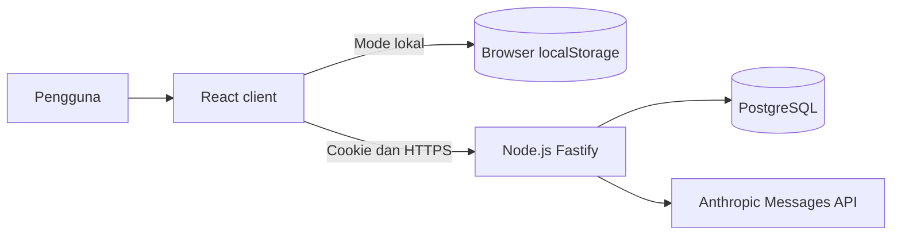
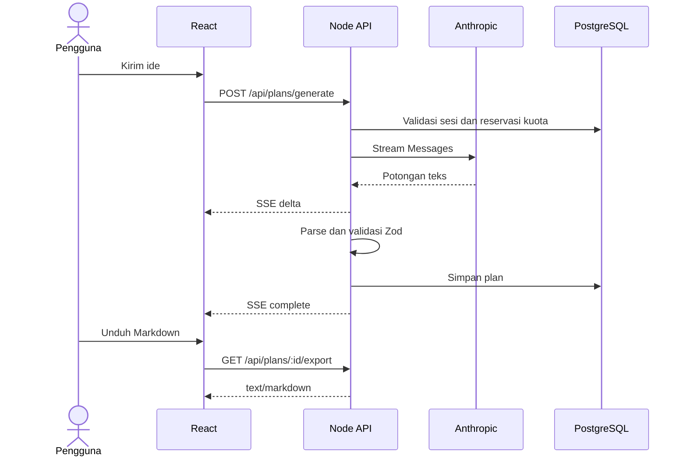
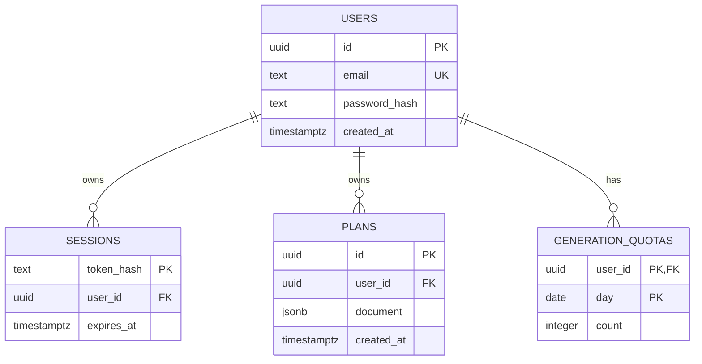

# Rancangan sistem

## Dua mode
Mode lokal: React memvalidasi ide dengan Zod, menyusun draf dari template, menyimpan plan pada localStorage, dan mengunduh Blob Markdown. Data tidak dikirim ke server.

Mode AI: React mengirim input ke Node.js. Node memvalidasi Origin/sesi/kuota, meneruskan ke Anthropic, memvalidasi JSON, menyimpan pada PostgreSQL, dan mengirim event complete. Ekspor dilakukan server.

Indeks: sessions.expires_at; plans(user_id, created_at DESC). Migrasi dijalankan sekali secara transaksional dengan advisory lock. Password memakai argon2. Token sesi acak 256 bit disimpan sebagai SHA-256, berlaku 14 hari. Cookie httpOnly, SameSite=Lax, secure di produksi. Semua mutasi memeriksa Origin tepat dan body maksimal 24 KB.

## Kontrak PRD
Minimal delapan bagian wajib: overview, goals, users, features, architecture, diagrams, tasks, questions. Mode template membuat 11 bagian; mode AI menerima 8–16 bagian dengan ID unik. Semua asumsi ditandai. Markdown mentah tidak mengeksekusi HTML. Mermaid strict memakai fallback kode bila parsing gagal.

## Batas arsitektur
- Node tidak dihosting di Sites statis; perlu deployment terpisah.
- Di versi ini JSONB menyimpan satu versi plan. Riwayat versi belum dibuat.
- Otorisasi berada di server/repository, tidak mengandalkan tombol client.
- Satu proses Node menyimpan pembatas satu generation aktif/pengguna di memori; kuota harian tetap atomik di database.
- Backup dan pemantauan produksi harus disiapkan sebelum menerima pengguna nyata.

